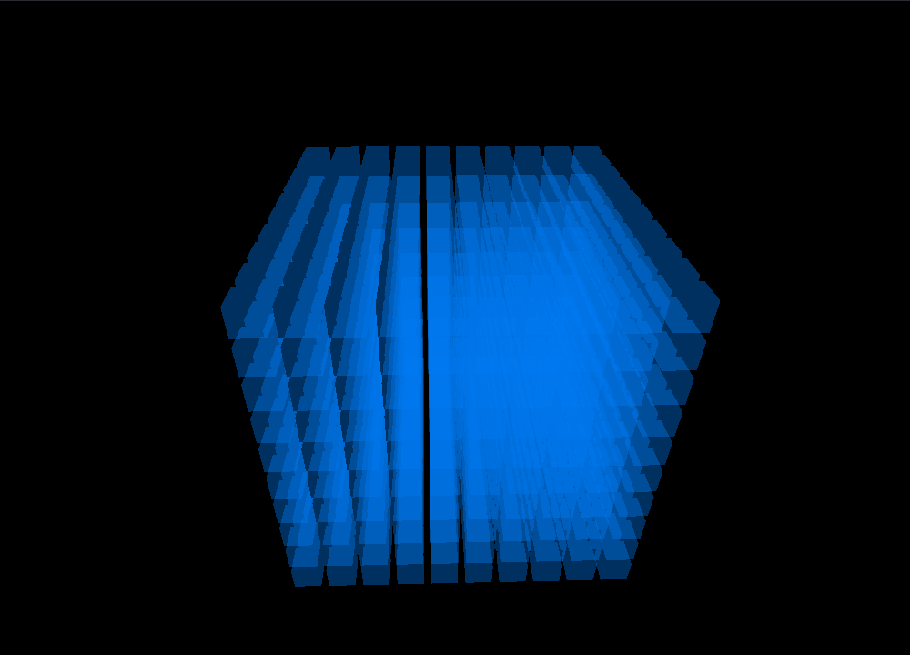

# hypercube-raylib

Cubo giratório composto por vários cubos menores, renderizado em tempo real
com C++17 e [raylib](https://www.raylib.com/).

> Apesar do nome, não é um tesseract (cubo 4D): "hypercube" aqui é só o
nome do projeto. A cena é um cubo 3D grande formado por uma grade de cubos menores.



## Requisitos

- Linux
- GCC com suporte a C++17 (GCC 7 ou superior)
- CMake 4.2 ou superior
- Ninja
- Git

### Dependências do sistema

#### Arch Linux

O raylib está disponível no repositório `extra`, então o CMake o encontra
via `find_package` sem precisar baixar nada:

```bash
sudo pacman -S --needed base-devel cmake ninja git raylib
```

Se preferir que o CMake baixe e compile o raylib (via `FetchContent`), instale
as bibliotecas que ele precisa em vez do pacote `raylib`:

```bash
sudo pacman -S --needed base-devel cmake ninja git \
    alsa-lib mesa glu libx11 libxrandr libxi libxcursor libxinerama
```

#### Outras distribuições

Instale os equivalentes desses pacotes (compilador, CMake, Ninja e headers de X11/OpenGL/ALSA).

## Compilando

```bash
git clone https://github.com/felipesantosdv/hypercube-raylib.git
cd hypercube-raylib
 
cmake -S . -B build -G Ninja -DCMAKE_BUILD_TYPE=Release
cmake --build build
```

## Executando

```bash
./build/hypercube
```

## Build de debug

```bash
cmake -S . -B build-debug -G Ninja -DCMAKE_BUILD_TYPE=Debug
cmake --build build-debug
```

## Configuração do CMake

Exemplo de `CMakeLists.txt` que usa o raylib do sistema:

```cmake
cmake_minimum_required(VERSION 4.2)
project(hypercube LANGUAGES C CXX)

set(CMAKE_CXX_STANDARD 17)
set(CMAKE_CXX_STANDARD_REQUIRED True)
set(SOURCES src/main.cpp src/grid.cpp src/renderer.cpp)

find_package(raylib REQUIRED)

add_executable(${PROJECT_NAME} ${SOURCES})

add_custom_command(TARGET ${PROJECT_NAME} POST_BUILD
    COMMAND ${CMAKE_COMMAND} -E copy_directory
        ${CMAKE_SOURCE_DIR}/assets $<TARGET_FILE_DIR:${PROJECT_NAME}>/assets)

target_link_libraries(${PROJECT_NAME} PRIVATE raylib)
target_compile_options(${PROJECT_NAME} PRIVATE -Wall -Werror -Wextra -Wpedantic)
```

## Estrutura do projeto

```tree
hypercube-raylib/
├── CMakeLists.txt
├── docs
│   └── preview.png
├── assets
│   ├── images
│   │   └── window_icon.png
│   └── shaders
│       ├── instancing.fs
│       └── instancing.vs
├── LICENSE
├── README.md
└── src
    ├── config.hpp
    ├── grid.cpp
    ├── grid.hpp
    ├── main.cpp
    ├── renderer.cpp
    └── renderer.hpp
```

## Como funciona

1. Uma grade N×N×N de cubos menores é gerada e posicionada no espaço 3D.
2. A cada frame, a câmera ou a rotação do conjunto é atualizada.
3. Cada cubo é desenhado com raylib dentro do loop principal.

## Licença

Distribuído sob a licença MIT. Veja o arquivo `LICENSE` para mais detalhes.

## Créditos

- Parte da lógica de projeção 4D → 3D foi baseada no vídeo
["Building 3D Snake From Scratch in C++"](<https://www.youtube.com/watch?v=f90_plD8LrA>) do canal Salar.
